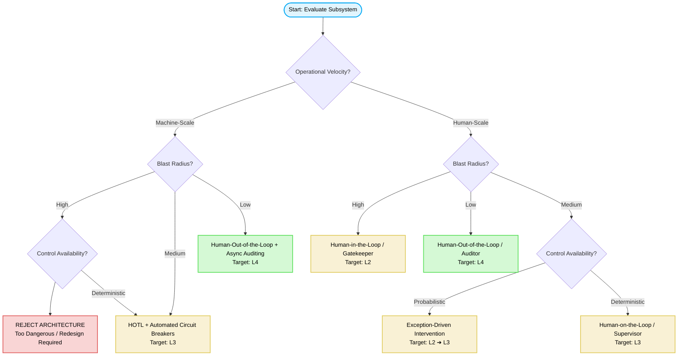

# Human Oversight for Agentic Systems

Human-in-the-Loop (HITL) is the intentional integration of human judgment at critical phases of an AI system’s lifecycle to guide behavior, correct errors, and ensure safety. HITL establishes the boundaries of shared responsibility between humans and algorithms. While HITL principles apply from initial data labeling through model training, this note focuses specifically on post-deployment human oversight and presents a draft checklist for designing effective oversight mechanisms.

***This note will focus on enterprise applications.***

An enterprise application differs from a general-purpose AI system: the input space has constraints, and the success criteria are strictly defined in most cases. Think of it like a washing machine 🧼. Their input space is broad (different fabrics, colours, size), but also limited (designed for washable objects). Limiting the input space allows engineers to define precise sequences with some flexibility in sequence stages: When you press "Start", the machine orchestrates: water intake, detergent release, agitation, and spinning. 

This controlled automation is made possible by combining two fundamental mechanisms:

* **Open-Loop controls:** For example, the cycle timer is an independent variable. It moves forward blindly, eventually stopping the machine without ever verifying if the clothes are actually clean.
* **Closed-Loop controls:** For example, the internal thermometer constantly samples the water temperature, feeding that data back into the system to regulate the heating element and maintain stability.

It took decades of human engineering to design the washing machines as we know it. I started with this analogy to highlight two messages:

1. Ability to design the right controls determines the level of automation.
2. Process automation is not autonomy. An application can chain together dozens of highly sophisticated automated systems, but that does not make the overarching system autonomous.

As we all know from our day-to-day experiences, at some point, an ambitious product owner working on a new washing machine project will inevitably ask (or already asked...): *“What if we embed an AI agent to our machine and let it decide adding an extra five minutes to the cycle or injecting more detergent?”*

While this introduces a layer of adaptive behavior, it exposes the ultimate bottleneck of automation and highlight our first message even more. Without a definitive sensor capable of measuring the actual objective (in this example, the literal cleanliness of the fabric) the agent will fly blind. Instead of achieving true autonomy, the system will simply make a combination of lucky streaks and educated guesses.

## **The Spectrum of Autonomy**

To design an effective human oversight, we first need to have a good definition for autonomy.

In the enterprise landscape, automation is rarely a binary switch. Designing an autonomous system/workflow requires deconstructing a process into its core subsystems to figure out exactly which pieces can be automated and which must remain manual.

Google’s SRE team recently shared their experience on using AI in their operations and how they define maturity levels in autonomy. [[🔗 Link]](https://cloud.google.com/blog/products/devops-sre/how-google-sre-is-using-agentic-ai-to-improve-operations) I'll use the same levels (as it aligns with most of the accepted taxonomies). They track operational autonomy across five distinct levels (the definitions are SRE-oriented, but easily generalisable for other domains):

* **L0 \- Manual Execution:** All operational tasks (e.g. investigation, approval, execution) are entirely human-driven.
* **L1 \- Assisted:** The system automates some tasks (e.g. monitoring and initial investigation) to provide data-driven insights, but a human must approve and manually execute any changes.
* **L2 \- Partial Autonomy:** The system can complete some tasks, but it strictly pauses to wait for explicit human approval before executing.
* **L3 \- High Autonomy:** The system independently detects, decides, and executes tasks without human intervention, but only within highly specific, tightly bounded scenarios.
* **L4 \- Full Autonomy:** The system is completely self-directed, autonomously resolving complex, multi-step issues and novel situations end-to-end without human oversight.

The real challenge for enterprise architects is that a large system is never at just one level. Instead, it is a mosaic of sub-components, each operating at its own tier of automation.

Crucially, injecting autonomy into a single sub-component does not magically elevate the overarching system. Consider system monitoring: in massive enterprise environments, using humans to track system health is fundamentally impossible due to the sheer volume and velocity of the data. As a result, the monitoring stage almost always adopts full autonomy (L3 or L4) out of sheer necessity.

However, if those autonomous monitoring tools simply dump alerts into a queue where a human must still manually diagnose, approve, and deploy a patch, the overall system’s autonomy remains firmly anchored at L0. Making one gear turn on its own doesn't make the entire machine autonomous if the primary decision-making engine is still entirely manual.

## **Safe and Reliable Automation with Proper Human Oversight**

Let’s first define how human oversight can occur in an agentic workflow. Here, I’ll focus on four archetypes:

1. **Human-in-the-Loop (HITL) / Gatekeeper:** The automation halts at a critical juncture. Execution cannot proceed without explicit human approval (e.g., L2).  
2. **Human-on-the-Loop (HOTL) / Supervisor:** The automation runs autonomously, but a human monitors the live telemetry with an immediate escalation mechanism with a clear link to a highest-priority incident resolution path (e.g., L3).  
3. **Exception-Driven Intervention (EDI) / Escaler:** The system operates autonomously *unless* an anomaly is detected, or an AI agent's confidence score drops below a parameterized threshold (e.g., \<95%). It then dynamically drops back to HITL.  
4. **Human-Out-of-the-Loop (HOOTL) / Auditor:** The system runs completely autonomously end-to-end (e.g., L4). Human oversight is purely retrospective via logs, post-mortems, and drift analysis.

But, how will we select the right approach in our agentic workflows? Well, we need to define some architecture decision points. Here, the potential candidates are:

- Blast radius of a failure mode  
- Availability of deterministic controls  
- Operational velocity

| Parameter | Options / Values | Description |
| :---- | :---- | :---- |
| **Blast Radius** | **High** ⏐ **Medium** ⏐ **Low** | What is the worst-case financial, operational, or safety consequence if the automation fails? (This parameter is highly correlated with risk, but it is not risk. Risk is a compound definition with two variables: impact and likelihood, here blast radius is more about potential impact) |
| **Deterministic control availability** | **Deterministic** ⏐ **Probabilistic** | Does the system have a definitive control mechanisms (Deterministic), or is it operating on heuristics and agentic "educated guesses" (Probabilistic)? |
| **Operational Velocity** | **Human-Scale** I **Machine-Scale** | Does the process run at a speed a human can naturally review (minutes/hours), or is it high-volume/sub-second (milliseconds)? |

This structured logic guides an architect through the parameters to select the correct oversight model:

#### **When the output velocity is low that embedding human oversight can scale:**

* **IF Blast Radius is High:** It doesn't matter if the sensor is deterministic or probabilistic; the risk demands human sign-off. (Unless the the output can be formally verified.)  
* **IF Blast Radius is Medium AND Verifiability is Probabilistic:** Let the agent propose the action, but route it to a human if confidence is shaky or the scenario is novel.  
* **IF Blast Radius is Medium AND Verifiability is Deterministic:** The system can verify its own success perfectly, so a human just needs to oversee the pipeline.  
* **IF Blast Radius is Low:** Low risk allows for full automation with standard logging.

#### **When the output velocity is high:**

*Because velocity is too fast for a human, HITL is physically impossible. Oversight must be systemic with a combined automated and human-in-the-loop approach.*

* **IF Blast Radius is High:** Architectural Redesign Required. We cannot safely run a high-risk, machine-scale autonomous system without breaking it into smaller, lower-risk sub-components, or introducing circuit breakers that artificially slow it down to Human-Scale.  
* **IF Blast Radius is Medium:** Humans supervise aggregate health metrics while automated guardrails (e.g., rate-limiters) handle instant containment if things go sideways.  
* **IF Blast Radius is Low:** We can afford Human-Out-of-the-Loop (HOOTL) with Async Auditing. (Similar to Google SRE’s automated log monitoring).

## **Limitations, Exceptions, and the Illusion of Oversight**

*All models are wrong, but some are useful.*[^1] The framework outlined above is no exception; it is a mental model with clear boundaries, limitations, and edge cases that architects must consider.

1. This entire framework rests on a massive prerequisite: **exceptional baseline performance**. We cannot responsibly discuss moving a system up the autonomy ladder, or taking humans out of the loop, unless the automation has already proven itself profoundly reliable and robust during exhaustive pre-deployment testing and real-world simulation.  
2. High-risk applications *can* defy these rules and achieve full autonomy, but only under a strict condition: **formal verification**. If an enterprise can mathematically prove or deterministically verify that an automated output is 100% compliant with safety parameters before it executes, the high-risk "blast radius" is effectively neutralized. (It is how risk works\! You prove the likelihood is 0, and you are fine\!)  
3. It is also vital to note that this framework looks at a very narrow slice of the architectural pie. We have focused entirely on **post-deployment human oversight**, which is only a fraction of the broader HITL paradigm. While our checklist looks at how humans supervise a live system, HITL often happens long before production. A prime example is **RLHF** where human evaluators score and rank the AI’s responses, teaching it nuance, safety, and cultural alignment before it ever sees a line of enterprise data.  
4. Yet, as AI systems become deeply embedded, ambient, and hyper-complex, we must ask a more existential question: **What does "human-in-the-loop" even mean anymore?** When does the loop start and when does it end? If a human uses an AI copilot to write code that generates an automated script to manage a server grid, who is actually in control?  
5. Finally, we must dismantle a dangerous engineering bias: **the assumption that adding human oversight automatically guarantees trust**. Do we trust the human managing the process? Are they reviewing an AI agent's complex proposal at the tail end of a brutal 12-hour shift? Are they distracted by multitasking across four other enterprise dashboards? Crucially, do they even possess the technical skill required to spot a highly sophisticated, hallucinated error made by an agent? When we design for human oversight, we must design for the human as they might be fatigued, distracted, and fallible.

## **Checklist**

Classifying automation levels provides a vital theoretical foundation, but safely deploying these systems into a production enterprise environment requires a practical playbook. Before designing a new workflow or letting an AI agent loose on a critical pipeline, architects must pressure-test their assumptions. The following eight-question operational framework bridges the gap between theory and execution, uncovering the exact design decisions required to guarantee reliable human oversight. These questions are designed to help structure human oversight decisions based on what I shared above.

**Pillar 1: Scope and classification**

* **1\. Rationale:** *What should be automated, and what is the business or operational justification for doing so?*  
* **2\. Scope:** *What exactly is being automated? What are the boundaries and dependencies of this specific subsystem?*  
* **3\. Control Mechanics:** *Is this a deterministic open/closed loop, or an adaptive agentic system? Where does it sit on the L0–L4 spectrum?*  

**Pillar 2: Human-machine-teaming policy**  
* **4\. Blast Radius:** *What is the worst-case scenario if this automation malfunctions, runs amok, or receives corrupted input?*  
* **5\. The Handoff Protocol:** *How, when, and why does the system escalate to a human? What is the explicit mechanism for a human to override and instantly deactivate the automation?*  
* **6\. Graceful Degradation:** *When the automation fails (and it will), how does the system safely degrade? Can the business still function manually at an L0 state?*

**Pillar 3: Control effectiveness monitoribility**  
* **7\. Verifiability:** *How does the system objectively measure success? Do we have a definitive "success sensor," or is the automation operating on educated guesses?*  
* **8\. Telemetry:** *How is the automation’s behavior made visible to humans in real time?.*  

[^1]: Quote from statistician George Box 