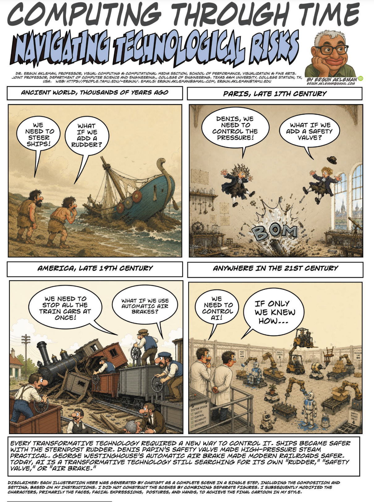

Technological history often unfolds through recurring crises and the determined people who work to resolve them. Software engineering is no exception; the discipline took shape in response to one such crisis. By the late 1960s, computing faced what practitioners called the "software crisis." Projects ran chronically late and over budget, and often failed in unexpected ways. The ambition of software had outgrown the methods used to develop it.

In October 1968, fifty-two computer scientists, programmers, and researchers gathered in Garmisch, Germany, under the sponsorship of the NATO Science Committee to confront this problem. They gave the meeting a deliberately provocative title: *Software Engineering* [^1]. The conference report documents the participants' effort to bring more systematic methods to software development {cite}`naur_software_1969`. At the time, engineering was an established profession, regulated and accountable to the public, while programming was largely an ad hoc craft guided by intuition. One participant compared the challenge of building modern software to constructing an unprecedentedly long bridge from unfamiliar materials for entirely new kinds of traffic. The organizers hoped that the term itself would help propel the young discipline toward greater rigor.

The Garmisch conference helped bring attention to the “software crisis,” but the problems it described had been developing for years and would persist for decades {cite}`naur_software_1969`.

> _There has always been a software crisis._ – {cite}`giddings_accommodating_1984`

Giddings argued that the crisis resulted from the failure to manage domain-dependent software—systems embedded in environments that change as the software changes them. The crisis was actually a structural condition, arising whenever the complexity of what we build outruns the discipline with which we build it {cite}`giddings84`.

We can see versions of this pattern in transformative shifts such as object-oriented programming, the internet, and cloud computing. New capabilities fuel ambitious projects, while leaving uncertainty about how best to implement them. Systems may be built quickly and at scale before their developers have fully absorbed the field's accumulated knowledge. In machine learning, for example, hidden dependencies and data-management costs can create technical debt that makes systems difficult to maintain {cite}`sculley_hidden_2015`. The field responds by developing methods and tools, and by professionalizing its practice—until another major capability brings new challenges.

This article draws four lessons from that history—managing complexity, reusing solutions, validating systems, and strengthening professional responsibility. These themes offer questions for the current development and adoption of AI:

1. How can we find our way in complexity?
2. How can we reuse solutions?
3. How can we validate the suggested pathways?
4. How can we endorse professional standards and bodies?

## 1. The Problem of Complexity

> Everything should be made as simple as possible, but no simpler - often attributed to Einstein.

Software is domain-dependent. It interacts with its environment, changes that environment, and is changed in return. The relationship between a software system and the world it inhabits is not fixed at design time. It evolves, and the software must evolve with it. This characteristic brings the inherent complexity of software systems.

Formal verification can establish that a system satisfies specified properties under stated assumptions, but it does not by itself establish that the specifications are complete or appropriate. Formal methods support assurance in suitable contexts; they do not eliminate the need for engineering judgment. AI risk management likewise calls for context-sensitive identification, measurement, and management of risks rather than a single assurance technique {cite}`nist_ai_rmf_2023`.

> Detailed knowledge of arcane system interfaces and languages is no substitute for knowing how to apply fundamental design principles. - Parnas

AI safety and security discussions also consider formal methods. In practice, assurance is often built from multiple techniques, including testing against functional and non-functional requirements, with the appropriate level of scrutiny depending on the system's context and potential impact. For example, an LLM used to draft a summary that a human reviews before sending to a customer presents a different risk profile from a system that acts without review. If unsafe outputs undermine the intended use or productivity, reducing them becomes a key functional and business requirement. The NIST AI RMF provides a risk-based framework for organizing this kind of assessment {cite}`nist_ai_rmf_2023`.

For highly consequential scenarios—such as systems with substantial autonomy in sensitive research and development—the acceptable level of risk and required evidence would be very different from those for a human-reviewed summarization tool. Formal methods may contribute to assurance, but no method can guarantee safety beyond the properties and assumptions it covers. This distinction reinforces the need to tailor assurance to the system's capabilities, deployment context, and potential consequences {cite}`nist_ai_rmf_2023`.

These are two ends of the application spectrum. In enterprise settings, autonomous agents often sit between them. A conventional program does what it is instructed to do. An agent, by design, acts on what it infers it should do: it perceives context, selects and takes an action, observes the consequences, and proceeds. The environment shapes the agent, and the agent shapes the environment. This autonomy and dependence on context have also been studied in fields such as dependable and ubiquitous computing. The handbook explores these connections in greater depth in later chapters.

## 2. The Problem of Reuse

Reusing components has long been a challenge in the software community. Finding the right abstraction is difficult: a module designed for one decomposition may require modification before it can be used in another. Searching for and adapting an almost-suitable component can sometimes take longer than writing one from scratch. Brooks discusses the broader costs and limits of reuse and software productivity in *The Mythical Man-Month* {cite}`brooks_mythical_1995`.

Now, the software and AI communities need to answer two key questions: one from the development perspective and one from the use perspective.
1. The use of AI in the SDLC is becoming standard. We can rewrite modules with little effort, but doing so may be highly inefficient and create interoperability challenges, requiring interfaces for every vendor and client. We still need frameworks and protocols that support modularity and interoperability. For example, the Model Context Protocol (MCP), introduced in 2024, defines a shared interface for connecting AI applications to external tools and data sources. It may reduce bespoke integration work, although interoperability still depends on compatible implementations, clear security boundaries, and well-defined behavior {cite}`mcp_spec`.

However, most of these efforts still come from people who began their software careers before AI tools and who continue to value modularity and interoperability. It remains an open question how behavior will change when agents can maintain entire codebases and develop their own protocols. How can we ensure that the protocols, frameworks, and interfaces agents create support interoperability?

2. Can we develop reusable approaches to alignment and control that have proved effective in previous models?

> The history of the internet is full of lessons about reusability and interoperability. The parallel to the early standardization of software interfaces is not coincidental. When the field finally agreed on common abstractions—file systems, network sockets, and HTTP—productivity improved dramatically. When agreement was fragmented or absent, each system had to reinvent the same solutions in incompatible ways.

The lesson from history is that the value of standards lies not only in the choices they make, but also in the fact that they establish common ground. HTTP may not be the ideal protocol for every purpose. It is, however, a protocol that allows browsers and servers to communicate. The productivity gains from that universality may outweigh the efficiency gains of a more carefully optimized proprietary protocol.

## 3. The Problem of Validation

> As a rule software systems do not work well until they (software) have been used, and have failed repeatedly, in real applications. Generally, many uses and many failures are required before a product is considered reliable. - Parnas, Parnas, van Schouwen, and Kwan

Most software fails in its first real use because situations not anticipated by programmers are also overlooked by test planners. Testing, however thorough, is a search through a space defined by the tester's imagination. What the tester cannot imagine, the test cannot reach.

This is the central problem of testing any complex system. It becomes acute when the system under test is itself a reasoning engine with broad discretion over its behavior. Agents can be evaluated more directly on tasks with objectively checkable outcomes, such as code generation against test suites; broader contextual judgment is harder to assess because success criteria may be ambiguous. Evaluation should therefore reflect the intended use and deployment context, not rely on a single benchmark {cite}`nist_ai_rmf_2023`.

The field of safety-critical software developed responses to this problem over many decades, including making critical components small, simple, and auditable, and separating safety-critical from non-safety-critical functions. Decomposition can help people reason about complex systems, but it does not automatically make a system reliable: interfaces, dependencies, and interactions between components also need analysis. Parnas's work on module decomposition offers a useful foundation for this principle {cite}`parnas_decomposing_1972`.

## 4. The Problem of Professionalism

Perhaps the deepest challenge is institutional as well as technical. Software engineering has developed professional codes, including the ACM/IEEE-CS Software Engineering Code of Ethics, but it does not have a universally required licensing regime. This leaves accountability distributed across organizations, professional communities, regulators, and the public. The code offers a shared ethical framework, but it cannot substitute for effective organizational and public accountability {cite}`acm_ieee_ethics_1999`.

The professional challenge persists in the AI era. Tools for building AI agents are increasingly accessible, while techniques for ensuring reliability, safety, and predictable behavior in novel conditions remain challenging. Engineering machine-learning systems involves data, infrastructure, and organizational concerns in addition to model behavior {cite}`amershi_software_2019,sculley_hidden_2015`. Evaluation should therefore be planned throughout development and deployment, rather than added only at the end. NIST's AI RMF provides a risk-based framework for this work {cite}`nist_ai_rmf_2023`.

## What We Should Do Differently

The history does not offer a formula. It offers a posture. That posture is one of disciplined skepticism toward any claim that a new capability has suspended the laws that have governed software development since the beginning. Those laws are not physical constants; they are regularities in the relationship between complexity, cognition, and failure. They can be managed, but they cannot be wished away.

Concretely, the history suggests several things. 

A common pattern is the need to transform tacit knowledge into standardized domain knowledge. Domain knowledge is tacit; it lives in judgment, not in rules. Any system that attempts to replace or augment human judgment must somehow engage with the tacit dimension of that judgment—and doing so requires collaboration between technical practitioners and domain experts, which is rarer and more difficult than either party typically anticipates.

The enterprises deploying AI agents are discovering, at some cost, that agents designed by engineers often lack the domain knowledge possessed by experienced practitioners in law, finance, medicine, and other fields. This is the same problem that structured analysis faced when it tried to formalize business processes it did not adequately understand, and the same problem that the first generation of expert systems encountered when they tried to encode knowledge that practitioners could not easily articulate. 

The problems of validation and evaluation must be treated as first-class design concerns. An agent that cannot be evaluated reliably cannot be deployed responsibly. The current tendency to ship agentic systems and learn from production failures is not a novel methodology; it is the old methodology, the one the 1968 conference was convened to criticize. Learning from production failures is necessary but insufficient, and in safety-sensitive domains it is unacceptable as a primary strategy.

Decomposition can make complex systems easier to understand, but it does not by itself make them trustworthy. Multi-agent architectures need explicit interfaces, clear contracts, and evaluation of both components and their interactions. The same modularity principles that support maintainable software can inform agent design, provided that integration risks are also addressed {cite}`parnas_decomposing_1972,sculley_hidden_2015`.

The domain dependence of AI agents is not a technical problem with a purely technical solution. An agent embedded in a legal environment must be developed in collaboration with lawyers. An agent embedded in a medical environment must be developed in collaboration with clinicians. The alternative—building an agent that is capable in the abstract and expecting it to acquire domain competence in deployment—is an experiment that the history of software suggests will be expensive. Gartner's 2025 forecast estimated that more than 40% of agentic AI projects would be canceled by the end of 2027, citing escalating costs, unclear business value, or inadequate risk controls; this is a forecast, not an observed cancellation rate {cite}`gartner_agentic_2025`. It supports the case for domain expertise and clear value criteria, but does not by itself establish that insufficient domain engagement is the cause of cancellations.

The field needs to develop something closer to a professional ethic around agentic systems. The engineering disciplines that Parnas held up as models are not better because their practitioners are more skilled. They are better because their practitioners are held accountable—to standards, to peers, to regulators, and ultimately to the public. Software never fully achieved this accountability, and the consequences have been visible in every decade since the 1960s. The deployment of autonomous systems that make consequential decisions on behalf of people who did not choose them and cannot easily audit them raises the stakes for that accountability to a level the field has not previously encountered.

Luckily, most great software engineers also enjoyed writing about their craft. We have many good resources here to explore.

I want to conclude this article with the comic I extracted from <https://doi.org/10.1109/MC.2026.3718129>

[^1]: The attendees came to the NATO conference with a shared unease. Software projects of the era were chronically late and over budget. Systems failed in ways nobody had anticipated. IBM's OS/360, perhaps the most ambitious software undertaking of the decade, had become a cautionary tale: it employed thousands of programmers, consumed a fortune, and still delivered something unreliable and resistant to change. A participant at Garmisch observed that he had never seen an engineer build a bridge of unprecedented span, with brand new materials, for a kind of traffic never seen before—but that, he said, was exactly what had been happening in software.