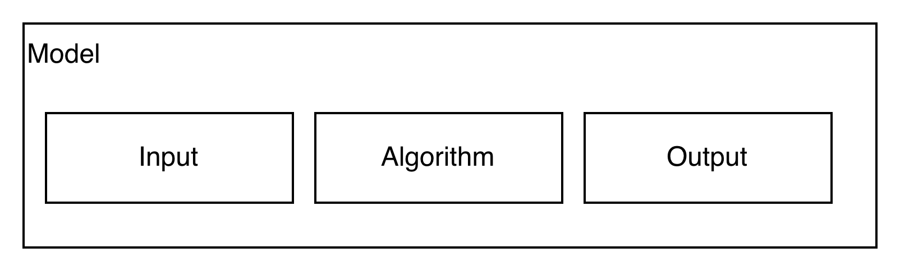
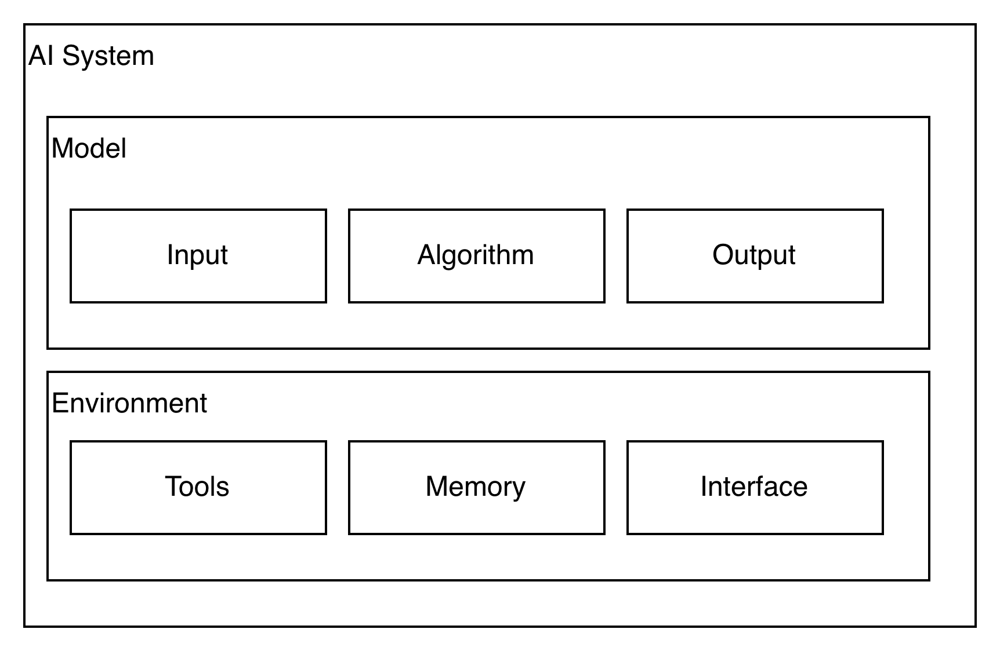
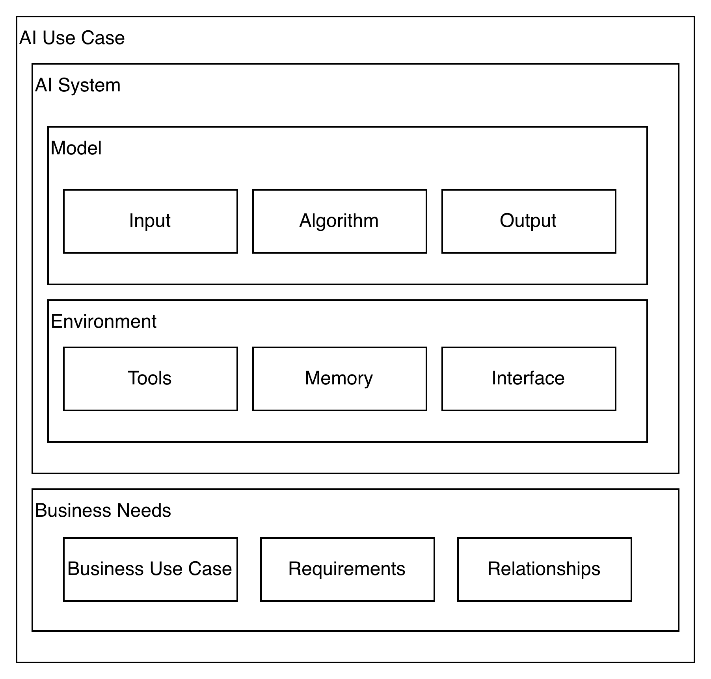
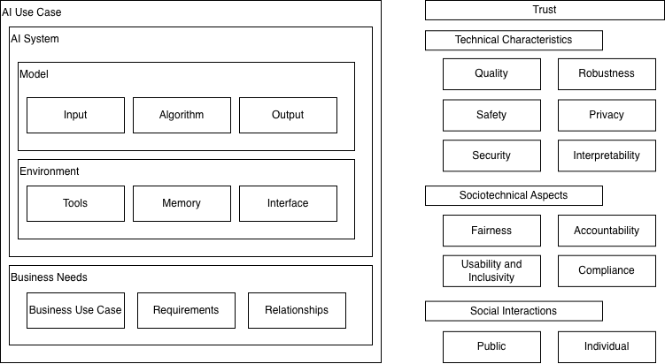

# Defining trust and trusted AI system

````{card}
This article aligns its terminology primarily with the following frameworks and definitions:
- [FSSCC AI Lexicon](https://fsscc.org/wp-content/uploads/2026/02/AIEOG-AI-Lexicon-February-2026.pdf)
- [NIST AI RMF](https://www.nist.gov/itl/ai-risk-management-framework)
- [OECD AI System Definition](https://www.oecd.org/content/dam/oecd/en/publications/reports/2024/03/explanatory-memorandum-on-the-updated-oecd-definition-of-an-ai-system_3c815e51/623da898-en.pdf)
````

In this handbook, *trusted AI* is used as a broad umbrella concept that encompasses safe, responsible[^rai], equitable, and trustworthy[^airmf] development. The term "trusted" also highlights the interactional dimension of AI systems: a technically trustworthy product does not automatically generate trust in practice, and conversely, a system with limited technical safeguards can still be trusted when it is supported by a sound sociotechnical design. These concepts do not have rigid boundaries; rather, they overlap substantially and reinforce one another in practice.

* _Safe_ means the system reliably performs in line with its designers' expectations {cite}`leslie_understanding_2019`. Safe AI therefore includes supporting sub-components such as robustness, security, and privacy, since these are essential to maintaining that reliability and accuracy.
* _Responsible_ is what distinguishes a product from merely reliable to genuinely trustworthy. Developing the system to be fair, transparent, and sustainable are examples of the characteristics that matter here. This aligns with established principles of engineering ethics and societal responsibility, such as [Ethics in Engineering](https://raeng.org.uk/policy-and-resources/education-policy/the-engineering-profession/global-responsibility-and-progressive-engineering-leadership/ethics/)
* _Equitable_ AI involves designing and using artificial intelligence systems in a just and inclusive way, ensuring they behave fairly and contribute to equality and inclusion in society. We often assume technology is neutral, and that its use determines whether it is a good or bad application. That may be true for some traditional rule-based systems, though even that is debatable. With AI, however, the technology can be inherently ill-designed because many current systems are trained on large-scale data. As a result, data collection and selection practices shape the behavior of the system itself. Moreover, access to substantial computational power is often a prerequisite for development, which restricts advanced AI capabilities to a narrower set of communities.
* _Trustworthy_ is another derived term, that encompasses characteristics such as safe, secure and resilient, explainable and interpretable, privacy-enhanced, fair with harmful bias managed, valid and reliable, and accountable and transparent (based on NIST AI RMF[^airmf]).

## Vocabulary

To establish the required trust sub-characteristics, we must understand the atomic components of an AI system and how they relate to one another. 



* **Model** is a mathematical construct designed to take information in and generate a result out. _Models are simplified representations of real-world relationships among observed characteristics, values, and events._ (directly extracted from [SR26-2](https://www.federalreserve.gov/supervisionreg/srletters/SR2602.htm))



* AI system: _The term 'artificial intelligence system'(A) means any data system, software, application, tool, or utility that operates in whole or in part using dynamic or static machine learning algorithms or other forms of artificial intelligence, whether(i) the data system, software, application, tool, or utility is established primarily for the purpose of researching, developing, or implementing artificial intelligence technology; or(ii) artificial intelligence capability is integrated into another system or agency business process, operational activity, or technology system; and(B) does not include any common commercial product within which artificial intelligence is embedded, such as a word processor or map navigation system._ (directly extracted from [FSSCC AI Lexicon](https://fsscc.org/wp-content/uploads/2026/02/AIEOG-AI-Lexicon-February-2026.pdf))


* **AI Use Case:** A concrete application of an AI system to solve a specific business problem, encompassing the model, data, and deployment context within an organizational setting. It bridges the technical AI system with real-world business outcomes and stakeholder interactions. {cite}`leone_de_castris_business_2025`




## Defining Trusted AI

To enable trust, we must ensure the system has strong _technical characteristics_ and positive _social interactions_ with well-established _sociotechnical aspects_.



Technical characteristics:

* **Quality:** Ensuring the system produces accurate, reliable, and consistent outputs that meet defined performance standards and user expectations.
* **Robustness:** How well the system handles unexpected data or "edge cases," distribution shifts, and adversarial inputs without degrading performance or failing unexpectedly.
* **Interpretability:** The ability for humans to understand *why* the AI made a certain decision, including which features influenced the output and how the model's logic can be explained.
* **Safety:** Ensuring the system does not cause physical, digital, or operational harm and behaves safely even under failure conditions.
* **Privacy:** Protecting the confidentiality and security of personal data used by and generated by the system, including compliance with data protection principles.
* **Security:** Safeguarding the system against malicious attacks (like "prompt injection"), unauthorized access, model manipulation, and data theft.

Sociotechnical aspects:

* **Fairness:** Ensuring the system doesn't produce biased or discriminatory results across different demographic groups and that outcomes are equitable and just.
* **Accountability:** Establishing clear ownership and responsibility for the system's decisions, outcomes, and any harm caused; enabling traceability and redress.
* **Usability and inclusivity:** Designing the system to be intuitive, accessible, and usable by all stakeholders regardless of technical expertise, ability, or background.
* **Compliance:** Ensuring the system adheres to applicable laws, regulations, standards, and ethical guidelines throughout its lifecycle.

Social Interactions:

* **Public:** The effect the AI has on society at large, including impact on employment, democratic processes, social structures, and collective well-being.
* **Individual:** How the AI affects a single person's rights, dignity, autonomy, and well-being, including informed consent and agency.


[^airmf]: The trustworthy AI definition is based on NIST's AI RMF: https://www.nist.gov/itl/ai-risk-management-framework
[^rai]: RAI definition is based on a combination of industry best practices, including [Google](https://research.google/teams/responsible-ai/), (Microsoft)(https://www.microsoft.com/en-us/ai/responsible-ai), [Accenture](https://www.accenture.com/gb-en/case-studies/data-ai/blueprint-responsible-ai)
[^iai]: The inclusiveness is based on inclusive HCI principles of [Microsoft](https://inclusive.microsoft.design/)